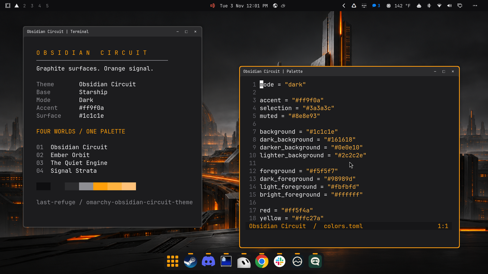
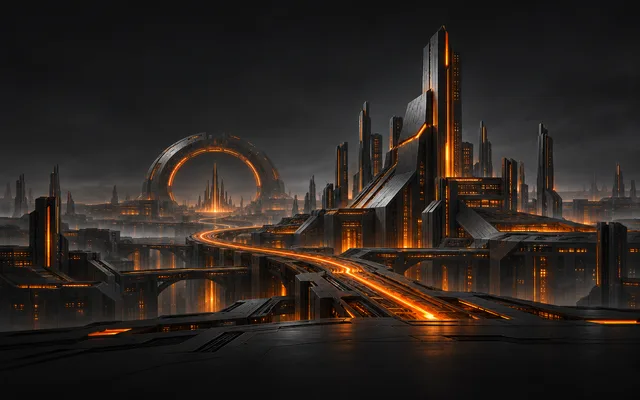
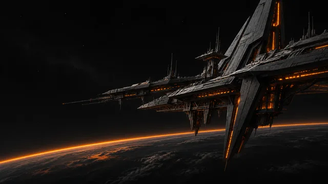
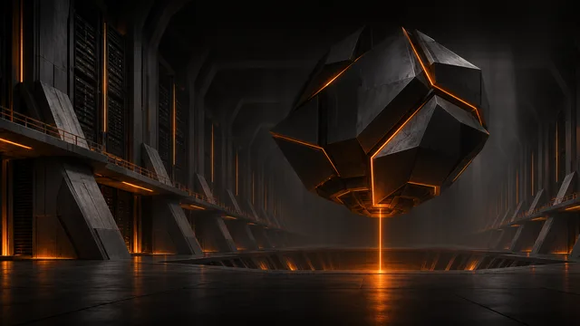
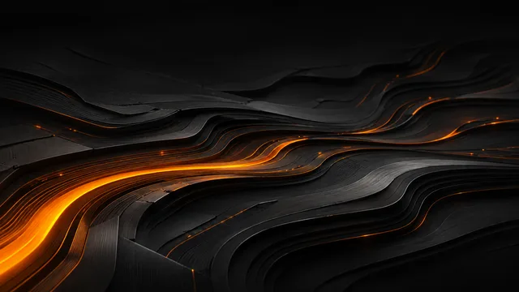

# Obsidian Circuit

A dark [Omarchy](https://omarchy.org/) theme with graphite surfaces, bright orange accents, and four futuristic wallpapers.



Desktop preview showing the orange active-window border and optional dock styling.

The palette builds on Omarchy's **Starship** theme. Obsidian Circuit adds custom shell surfaces and a collection of AI-generated science-fiction artwork. The top bar has a solid near-black background with no edge border. Menus use charcoal surfaces and orange selection accents.

## Install

```bash
omarchy theme install https://github.com/last-refuge/omarchy-obsidian-circuit-theme.git
```

You can also paste the repository URL into Omarchy's theme installation menu. After installation, select **Obsidian Circuit** in the theme selector.

If you previously made your bar transparent, set its background to opaque:

```bash
omarchy bar background opaque
```

The theme does not replace your widget layout, pinned applications, fonts, or keyboard shortcuts. Machine-level overrides in `~/.config/omarchy/shell.toml` take precedence over the theme.

## Wallpapers

| Obsidian Circuit | Ember Orbit |
| --- | --- |
| [](backgrounds/1-obsidian-circuit.png) | [](backgrounds/2-ember-orbit.png) |
| A city of black monoliths and orange energy conduits. | An angular space station above a dark planet. |

| The Quiet Engine | Signal Strata |
| --- | --- |
| [](backgrounds/3-the-quiet-engine.png) | [](backgrounds/4-signal-strata.png) |
| A faceted machine suspended inside a monumental chamber. | An abstract landscape of graphite layers and orange signal paths. |

The cityscape is the default wallpaper. Open the background selector or cycle through the collection:

```bash
omarchy theme bg-switcher
omarchy theme bg next
```

The PNGs are the original generated assets. Their native dimensions and exact generation prompts are documented in [Artwork](docs/ARTWORK.md).

## Optional dock styling

The desktop dock can also use a borderless graphite plate, orange hover accents, an orange app-grid icon, and running-app markers. This is a separate, optional modification to a user-owned clone of the Omarchy dock; installing the theme does not install or execute it.

See [the dock instructions](extras/dock/README.md) for installation, compatibility, backups, and removal.

## Compatibility

Developed on **Omarchy 4.5.0-rc3**. The palette and wallpapers use the standard Omarchy theme format. The custom shell surface tokens and optional dock patch are tested against the shell shipped with that version; older releases may ignore unsupported surface tokens. The dock patch is specifically version-sensitive.

See [Validation](docs/VALIDATION.md) for the checks performed and [Submitting to the theme gallery](docs/SUBMITTING.md) for the prepared gallery assets.

## Credits and license

- **Starship palette:** derived from [Omarchy's Starship theme](https://github.com/omacom/omarchy/tree/quattro/themes/starship), by the Omarchy project. The original palette is retained.
- **Shell and dock foundations:** [Omarchy](https://github.com/omacom/omarchy), copyright David Heinemeier Hansson, MIT.
- **Artwork:** generated using OpenAI's built-in image generation tool, with prompts developed for this theme. No stock Starship wallpaper is included.
- **Theme packaging and customization:** [Last Refuge](https://github.com/last-refuge).

Distributed under the [MIT License](LICENSE). See [Attribution](docs/ATTRIBUTION.md) for the source provenance.
